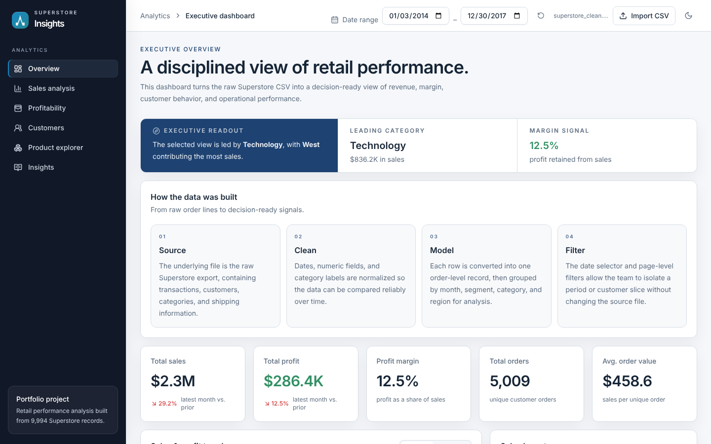

# Superstore Sales Analytics Dashboard

An end-to-end retail analytics project: raw Superstore order data is cleaned and explored in Python, then served through an interactive React + TypeScript dashboard that is built and deployed automatically to GitHub Pages.

**[▶ Live dashboard](https://haiderimran019.github.io/Sales-Data-Dashboard/)**



## At a glance

| | |
| --- | --- |
| **Dataset** | Sample Superstore, 9,994 order lines (2014–2017) |
| **Analysis** | pandas · Jupyter (exploration, cleaning, sales analysis) |
| **Dashboard** | React 18 · TypeScript · Vite · Tailwind CSS · Recharts |
| **Delivery** | GitHub Actions → GitHub Pages on every push to `main` |

## What the dashboard shows

- **Executive overview** — total sales, profit, margin, orders and average order value, with month-over-month change and an auto-generated readout of the leading category and region.
- **Sales analysis** — clickable category → sub-category drill-down, top states by revenue, and segment mix by ship mode.
- **Profitability** — margin by category and region, and the impact of discounting on profit.
- **Customers** — segment comparison (Consumer, Corporate, Home Office) and customer value.
- **Product explorer** — searchable, sortable product table filtered by sub-category.
- **Insights** — plain-language summaries of the patterns in the selected period.

Every view responds to the date-range filter. You can also **import your own CSV** in the same Superstore format, and switch between light and dark mode.

## How the data flows

```text
data/raw/Sample-Superstore.csv
        │  notebooks/01_data_exploration.ipynb   inspect structure and quality
        │  notebooks/02_data_cleaning.ipynb      fix types, dates and categories
        ▼
data/processed/superstore_clean.csv
        │  notebooks/03_sales_analysis.ipynb     trends, margins, segments
        │  webapp/scripts/copy-data.mjs          copied into the app at build time
        ▼
webapp/  (React dashboard)  ──GitHub Actions──▶  GitHub Pages
```

## Project structure

```text
├── data/
│   ├── raw/                 Original Superstore export
│   └── processed/           Cleaned CSV used by the dashboard
├── notebooks/               Exploration, cleaning and analysis notebooks
├── webapp/                  React + TypeScript dashboard
│   ├── src/pages/           Overview, Sales, Profitability, Customers, Products, Insights
│   ├── src/lib/analytics.ts Aggregation and KPI logic
│   └── scripts/             Build-time data copy
├── dashboard.py             Lightweight pandas-only version served locally
└── .github/workflows/       Build and deploy pipeline
```

## Run it locally

**React dashboard**

```bash
cd webapp
npm install
npm run dev
```

**Python version** (no Node needed)

```bash
pip install pandas
python dashboard.py        # opens http://127.0.0.1:8000
```

## Notes

Built for learning and portfolio purposes using the public Sample Superstore dataset. The figures describe that sample data, not a real business.
