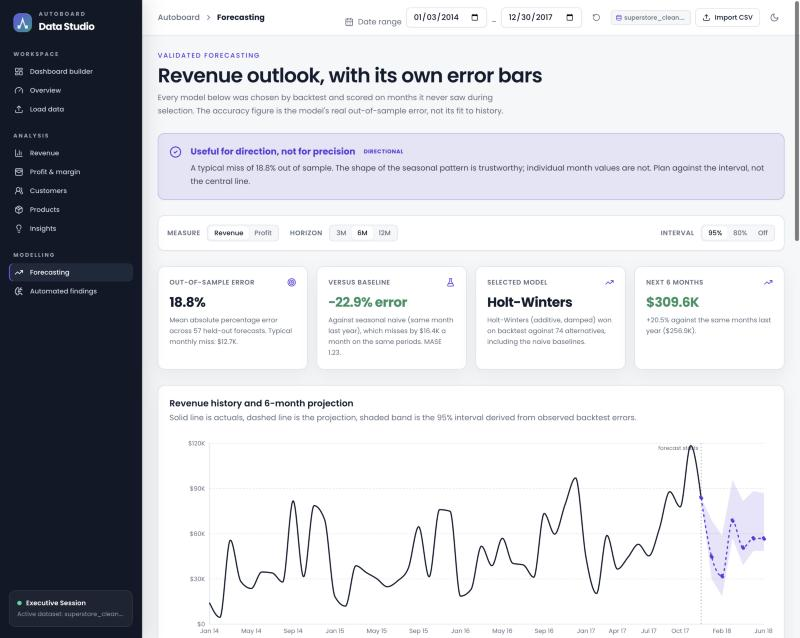

# Autoboard — a sales dashboard that reports its own forecast error

Live dashboard: **https://haiderimran019.github.io/Sales-Data-Dashboard/**



Most dashboards built on the Superstore dataset draw a trend line into the future and
leave it there. This one measures how wrong that line is, says so on the page, and
refuses to dress up a projection it cannot back.

The headline result, reproducible with one command:

| | Selected model | Seasonal naive baseline | Linear trend |
|---|---|---|---|
| **Monthly revenue, holdout MAPE** | **18.8%** | 23.6% | 35.2% |
| Holdout MAE | $12,676 | $16,442 | $21,397 |
| MASE | 1.23 | 1.60 | 2.08 |

Holt-Winters with an additive season and damped trend, selected on 2014–2016 and scored
on 57 forecasts across a 2017 holdout it never saw during selection. It cuts forecast
error **22.9% against the seasonal-naive baseline** and **41% against the linear trend**
a typical tutorial dashboard would ship.

Monthly **profit** is a different story, and the dashboard says so in red: 83.3% MAPE.
At that error the monthly line is noise. Reporting that is the point.

```bash
cd webapp && npm install && npm run validate:forecast
```

That command runs the backtest through `src/lib/forecaster.ts` — the same engine the
browser runs — so the numbers above cannot drift away from the code.

---

## Why the accuracy number is trustworthy

Three things usually go wrong when a dashboard claims forecast accuracy. This project
avoids all three deliberately.

**1. Error is measured out of sample, on a rolling origin.**
The model is handed history up to some month, asked for the next six, and scored against
what actually happened. That repeats across every origin with enough training data. No
figure on the page comes from a model scoring its own fit to data it had already seen.

**2. Model selection and model scoring never touch the same months.**
75 candidates — naive, seasonal naive, linear trend, and a grid of Holt-Winters
variants — compete on an early block of origins. The winner is then measured on a later
block held back entirely from that competition. Selecting and scoring on the same periods
is the most common way an honest-looking accuracy number gets inflated.

**3. Prediction intervals come from observed errors, not from the model's own residuals.**
The 80% and 95% bands are empirical quantiles of actual backtest errors, bucketed by how
many months ahead the forecast was made. A model's in-sample residuals would have made
the bands look far tighter than the forecast deserves.

The dashboard also shows the things most projects hide: per-horizon error (a six-month
forecast misses by more than a one-month forecast, and you can see exactly how much more),
the full model bake-off with the losing candidates, the holdout window, and a plain-English
statement of what the forecast cannot know.

### Verdicts, not just numbers

An accuracy figure is useless without a judgement attached, so the engine issues one:

- **Strong** — under 15% error and beating the baseline. Plan against it.
- **Moderate** — under 30% and beating the baseline. The seasonal shape is trustworthy; individual months are not.
- **Weak** — too noisy to act on, or no better than a naive guess. Shown anyway, flagged in red.

Revenue lands on *moderate*. Profit lands on *weak*. Both verdicts are computed, not hand-written.

---

## The rest of the dashboard

- **Dashboard builder** — drop in a CSV, Excel, PDF or Word file and get KPIs, trend charts and breakdowns. Column detection is fuzzy, so `Revenue`, `Amount` or `Total` all map to sales.
- **Revenue, Profit & margin, Customers, Products** — the standard analytical cuts, filterable by date range.
- **Insights** — ranked findings computed from the rows in range.
- **Automated findings** — a deterministic rule engine, explicitly *not* a language model. Every finding is labelled `measured` (arithmetic), `inferred` (a judgement) or an action, and every figure in the prose is shown alongside the computation that produced it. Findings that do not apply to the loaded data are omitted rather than filled with a plausible default.
- **Forecasting** — described above.

Everything runs in the browser against the bundled dataset. There is no backend to start,
nothing to sign into, and no uploaded file leaves the machine.

## Running it

```bash
cd webapp
npm install
npm run dev              # http://localhost:5173
npm run build            # production build
npm run validate:forecast   # reproduce the accuracy table above
```

### Optional backend

A FastAPI service lives in `backend/` providing Google sign-in, saved projects, server-side
ingestion and profiling, and Gemini-backed analysis. **The dashboard does not need it.** It
is only contacted when `VITE_API_URL` is set at build time; left unset, the frontend never
attempts a network call and runs entirely standalone.

```bash
cd backend
pip install -r requirements.txt
cp .env.example .env
uvicorn app.main:app --reload
pytest
```

## How it is built

**Frontend** — React 18, TypeScript, Vite, Tailwind, Recharts, Papa Parse, PDF.js.
**Forecasting** — written from scratch in TypeScript, no statistics library.
**Backend (optional)** — FastAPI, SQLAlchemy, Alembic, Gemini.
**Data** — the Sample Superstore dataset, 9,994 order lines, Jan 2014 to Dec 2017.

```
webapp/src/lib/forecaster.ts       model library, backtest, selection, intervals
webapp/src/lib/aiAnalyst.ts        rule-based findings engine
webapp/src/pages/ForecastingPage.tsx   accuracy and validation UI
webapp/scripts/validate-forecast.mjs   reproduces the README numbers
notebooks/                         exploration, cleaning and analysis
backend/                           optional FastAPI service
```

## Honest limitations

- One dataset. 48 monthly observations is a short series; the holdout is 12 origins. The error estimates carry real sampling uncertainty and the README does not pretend otherwise.
- The model extrapolates level, trend and seasonality. It knows nothing about pricing, stock-outs, marketing or competitors, so a deliberate change to the business breaks it before the error bars do.
- Accuracy is dataset-specific. Load a different file and selection and validation re-run from scratch; the figures on the page change with it.
- Discount-versus-margin findings are associations across order lines, not controlled experiments.

## License

MIT — see [LICENSE](LICENSE).
